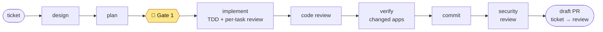

# claude-turbo-workflow

A [Claude Code](https://code.claude.com) plugin marketplace with one plugin, **`turbo-workflow`**: it takes one ticket from your tracker to a draft GitHub PR in a Turborepo monorepo.

```text
design → plan → 🛑 Gate 1 → TDD per task → code review → verify each changed app
       → commit → security review → push + draft PR → ticket to review
```

You approve the design and the plan (Gate 1). Everything after that runs without a question unless something leaves the plan, and a stopped run resumes at the exact task step.



The full chart, the questions it asks and what each run produces: [docs/workflow.md](docs/workflow.md).

## Install

In Claude Code:

```text
/plugin marketplace add Tiennd0502/claude-turbo-workflow
/plugin install turbo-workflow@claude-turbo-workflow
```

It needs Claude Code, Node.js ≥ 24, git, `gh` signed in to GitHub, and the `superpowers` plugin from `claude-plugins-official` (a declared dependency). For the `trello` tracker, Claude Code must be signed in with a claude.ai account that has the Trello connector.

## Quick start

1. In your Turborepo, run `/turbo-workflow:init`. It reads the repo, asks every value (tracker, branches, package manager, apps, shared paths) with the detected one as the recommended answer, shows the files it will write, and writes them only after you confirm.
2. Fill the `<TODO>`s in each app's `apps/<app>/.claude/rules/coding.md` and `testing.md`, commit the new files, and start a new session.
3. Run one ticket:

   ```text
   /turbo-workflow:work-ticket https://trello.com/c/<id>/...
   /turbo-workflow:work-ticket "Add a GET /health route that returns {ok:true}"   # tracker none
   ```

4. Review the draft PR on GitHub and mark it ready. After the merge, the ticket moves to done (or run `/turbo-workflow:work-ticket <ticket> done`).

## Commands

| Command | What it does |
| --- | --- |
| `/turbo-workflow:init` | sets up or edits the project config |
| `/turbo-workflow:work-ticket <ticket \| "task" \| task.md>` | runs one ticket end to end |
| `/turbo-workflow:work-ticket <spec dir>` | resumes a stopped run |
| `/turbo-workflow:work-ticket <ticket> done` | after the merge: ticket to done, local branch deleted |
| `/turbo-workflow:ticket-status [spec dir]` | where a run stopped, read only |
| `/turbo-workflow:pr-description` | drafts a PR description for the current branch |
| `/turbo-workflow:ui-screenshot` | before / after screenshots of a UI change |

## Documentation

- [How the workflow runs](docs/workflow.md): the flow chart, gates, ticket states, files, changed apps, resume.
- [Project configuration](docs/configuration.md): `.claude/workflow.json` fields, per-app files, trackers.
- [Plugin internals](docs/architecture.md): what is in the plugin and how the pieces connect.
- [Plugin README](plugins/turbo-workflow/README.md): install for a team, update.

## Team setup

`/turbo-workflow:init` adds these keys to the project's `.claude/settings.json`. Commit them, and teammates get the plugin after they trust the folder:

```json
{
  "extraKnownMarketplaces": {
    "claude-turbo-workflow": { "source": { "source": "github", "repo": "Tiennd0502/claude-turbo-workflow" } }
  },
  "enabledPlugins": { "turbo-workflow@claude-turbo-workflow": true }
}
```

To use it in the claude.ai apps too, add this repo under claude.ai → Customize → Plugins → Add → Add marketplace. Cloud sessions on claude.ai/code do not install plugins a repository declares.

## Update

```text
claude plugin update turbo-workflow
```

Then `/reload-plugins`. Releases are tagged `turbo-workflow--v<version>`.

## Develop

```bash
node --test "plugins/turbo-workflow/tests/*.test.mjs"   # script and hook tests
claude plugin validate . && claude plugin validate plugins/turbo-workflow
claude --plugin-dir "$PWD/plugins/turbo-workflow"        # load this checkout in a project
```

Release: bump `version` in `plugins/turbo-workflow/.claude-plugin/plugin.json`, commit, then `claude plugin tag plugins/turbo-workflow --push`.

## Limits

- Turborepo monorepos only (apps in sub-folders); a single-app repo is not supported yet.
- GitHub only for PRs (`gh`); trackers `trello` and `none`.
- Desktop notifications on macOS only.
